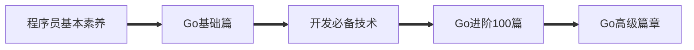

# 菜鸟的成长手册

## 🧭 导航

+ 🔍[**快速指南(wike) — 仓库总结**](https://github.com/cubxxw/Block_Chain/wiki)

+ 🔗[**中国大陆加速地址（Gitee平台）**](https://gitee.com/xxw3293172751/Block_Chain)

+ 📵[**不限速在线个人云盘**](https://xxw.cubxxw.com/s/wRSz)

  

  
  
  
  
  
  

	<a href = "https://github.com/cubxxw/cs-awesome-Block_Chain">🅱️GitHub</a>
	&emsp;&emsp; | &emsp;&emsp;
	<a href="https://interview.huihut.com">📚DocCub</a>

	<a href = "readme_english.md">🔤English</a>
	&emsp;&emsp; | &emsp;&emsp;
	<a href = "README.md">🆑中文CN</a>

 

<b>💡 关于</b>

<a href='https://www.facebook.com/profile.php?id=100034435372354'>Facebook</a> | <a href='https://telsacoin.io/'>Website</a> | <a href='http://cubxxw.com'>Blog</a> | <a href='https://t.me/smile3293172751'>Telegram</a> | <a href='https://twitter.com/xxw3293172751'>Twitter</a> | <a href='https://www.linkedin.cn/injobs/in/xiongxinwei-xiong-7606a0227'>Linkedin</a> | <a href='https://liberapay.com/xiongxinwei/donate'>Donate</a>

 ⚠️ 这是一个菜鸟的成长记录，如果你也想成为工程师，想从事后端的相关工作，或者想了解区块链的相关知识，那么它可以帮助到你😎 —>  <b>喜欢请给个⭐收藏~</b>

 🐧 喜欢*Go*语言的朋友欢迎加入*Go*语言自学群（*QQ*群号：[141984758](https://qm.qq.com/cgi-bin/qm/qr?k=ZZnzhuU8uGmIKT5btI9uiCRpasUeD8e2&jump_from=webapi&authKey=x1/NMrS1KpK7N8Rvj4IfLcKYSWnjtElgU6a3ubin1JmtReyuoIlyE/ZJ0VRlK25n)）

 ⛓️ <b>区块链技术（也称之为分布式账本技术）</b>，是一种互联网数据库技术，其特点是去中心化，公开透明，信息不可篡改性，隐私匿名性🤑<a href="https://github.com/C-UB">CUB链学社</a>致力打造<b>区块链自学教育平台。</b>

💡 侧边目录支持方式：[📚 DocCub 文档](https://go.cubxxw.com)、🗃️[Github + TOC 导航](http://sm.cubxxw.com/sm20221004130721.png?xxw@cubxxw.com)， 😍 甚至你可以在这个界面按下`.` ➡️ [进入vscode编译环境](https://cubxxw.com/archives/githubdev) 

👣 存在数学公式无法正常显示问题，强烈推荐[:triangular_ruler: MathJax Plugin for Github](https://chrome.google.com/webstore/detail/mathjax-plugin-for-github/ioemnmodlmafdkllaclgeombjnmnbima) 插件使用。

📄 保存为 PDF 方式：使用 Chrome 浏览器打开 <a href="https://go.cubxxw.com">📚 DocCub 文档</a> 页面，缩起左侧目录-右键 - 打印 - 选择目标打印机是另存为PDF - 保存  —— [🖨️以Go语言第一节打印效果预览.pdf](./images/copy.pdf)）

🙏 仓库内容如有错误或改进欢迎 [issue](https://github.com/cubxxw/cs-awesome-Block_Chain/issues) 或 pr，[🧷参与贡献](https://cubxxw.com/archives/contributors)，建议或讨论可在 [#10](https://github.com/cubxxw/cs-awesome-Block_Chain/issues/10) 提出。由于本人水平有限，仓库中的知识点有来自本人原创、读书笔记、书籍、博文等，非原创均已标明出处，如有遗漏，请 [issue](https://github.com/cubxxw/cs-awesome-Block_Chain/issues/new/choose) 提出。本仓库遵循 [CC BY-NC-SA 4.0（署名 - 非商业性使用 - 相同方式共享）](https://github.com/huihut/interview/blob/master/LICENSE) 协议，转载请注明出处，不得用于商业目的。

 

## 🔥 CubDoc推出

🈺 存在`GitHub`上浏览效果不佳，[Cub链学社](https://github.com/C-UB)推出`CubDoc`文档形式，使用`vuejs`渲染 。使用国内的服务器搭建（速度嘎快:bullettrain_front:) 。目前支持以下的项目🗃️：

+ [x] [:speedboat: Go语言基础-进阶](https://go.cubxxw.com)

+ [x] [:speedboat: docker & k8s & 云原生](https://docker.cubxxw.com)

 

## 🗓️ My 订阅精选

#### 博客专栏

博客上面发表的文章具有独立性，是我参与开源项目以来，所见所得所学，希望这种模式可以成功并且得以模仿。[👀 我的博客](https://cubxxw.com/) 记录着很多优质的内容值得一看，如果希望订阅 RSS ➡️[点这里](https://cubxxw.com/index.xml)

[][zhihu] 

[zhihu]: https://www.zhihu.com/people/3293172751

<b>📚 我的博客订阅（每周更新❗）</b>

 
🔥 博客专栏<b>每个工作日11：59自动更新一次（actions部署）</b> ，喜欢文章关注点赞👍噢~

<!-- My-Blog:START -->
- [Tana 产品拆解：一条任务怎样从笔记走到会议中的工作](https://cubxxw.com/zh/ai-agent/posts/tana-from-notes-to-meeting-work/)
- [Doneas 产品拆解：一周计划怎样变成每天的承诺](https://cubxxw.com/zh/ai-agent/posts/doneas-weekly-commitments/)
- [Ambi 产品拆解：记住一件事之后，怎样把它做完](https://cubxxw.com/zh/ai-agent/posts/ambi-memory-to-work/)
- [2026年10月思考笔记：日常与其他、AI 与 Agent 系统、工程与开源](https://cubxxw.com/zh/growth/posts/2026-10-thought-notes/)
- [Nango 接入实战：让用户在聊天中添加自己的 MCP](https://cubxxw.com/zh/ai-agent/posts/nango-user-defined-mcp-integration/)
- [Personal Agent 技术研究：OpenClaw 怎样把一次运行接到长期事务上](https://cubxxw.com/zh/ai-agent/posts/personal-agent-harness-openclaw/)
- [Personal Agent 产品研究：Instinct 怎样让人愿意再次委托](https://cubxxw.com/zh/ai-agent/posts/personal-agent-product-delegation/)
- [2026年9月思考笔记：AI 与 Agent 系统、日常与其他、工程与开源](https://cubxxw.com/zh/growth/posts/2026-09-thought-notes/)
- [Opus 5.5 为什么更会做动画：从真实工程拆解视觉能力跃迁](https://cubxxw.com/zh/ai-agent/posts/opus-55-visual-capability/)
- [一个人如何维护自己的界面：用 Figma、Figwright 与 AI 搭建设计系统](https://cubxxw.com/zh/engineering/posts/2026-09-26-figma-figwright-personal-design-system/)
- [AI 从业者是如何利用 AI 学习英语的](https://cubxxw.com/zh/growth/posts/ai-english-learning/)
- [用 AI 把文章做成可操作的解释：从 Web Components 到 MCP Apps](https://cubxxw.com/zh/ai-agent/posts/writing-explorable-articles-with-ai/)
- [IMStage：用于测试与评测的合成对话](https://cubxxw.com/zh/projects/imstage/)
- [2026年8月思考笔记：AI 与 Agent 系统、日常与其他、工程与开源](https://cubxxw.com/zh/growth/posts/2026-08-thought-notes/)
- [AI 让我更聪明，也让我更晚碰到现实](https://cubxxw.com/zh/growth/posts/2026-08-15-ai-made-me-smarter-later-to-reality/)
- [不会让恐惧替我做决定](https://cubxxw.com/zh/growth/posts/2026-08-10-fear-does-not-decide-for-me/)
- [Agent 不是一种产品：十套系统如何重新分配控制权、状态、身份与副作用](https://cubxxw.com/zh/ai-agent/posts/agent-system-design-synthesis/)
- [Conversation as Database：OpenHands 的无状态 Agent 与事件运行时](https://cubxxw.com/zh/ai-agent/posts/agent-system-design-openhands/)
- [多 Agent 辩论真的增加了信息吗：TradingAgents 的组织图与相关性风险](https://cubxxw.com/zh/ai-agent/posts/agent-system-design-tradingagents/)
- [Instructions as Code：OpenMontage 如何用工件契约编排视频生产](https://cubxxw.com/zh/ai-agent/posts/agent-system-design-openmontage/)
- [拒绝成为 Agent：TaxHacker 为什么把 LLM 压缩成一个函数](https://cubxxw.com/zh/ai-agent/posts/agent-system-design-taxhacker/)
- [OpenClaw 的常驻网关：连续性不是把所有消息塞进同一会话](https://cubxxw.com/zh/ai-agent/posts/agent-system-design-openclaw/)
- [n8n 的确定性外骨骼：Queue、Worker 与副作用从不承诺 Exactly-Once](https://cubxxw.com/zh/ai-agent/posts/agent-system-design-n8n/)
- [给 Agent 一台电脑之后：Manus 如何把回复变成交付物](https://cubxxw.com/zh/ai-agent/posts/agent-system-design-manus/)
- [Codex 的协议化内核：第二个 Surface 不该复制第一个 Agent](https://cubxxw.com/zh/ai-agent/posts/agent-system-design-codex/)
- [Pi 的减法：最小 Agent Kernel 保留什么，责任又去了哪里](https://cubxxw.com/zh/ai-agent/posts/agent-system-design-pi/)
- [Claude Code 的扩展语法：一条仓库修改怎样逐级获得控制](https://cubxxw.com/zh/ai-agent/posts/agent-system-design-claude-code/)
- [n8n 入门：给超级个体搭一条会被结果改写的增长流水线](https://cubxxw.com/zh/growth/posts/super-individual-growth-os-n8n/)
- [历史不能只活在一个尺度里：与 Archer 的一场夜谈](https://cubxxw.com/zh/growth/posts/history-needs-more-than-one-scale/)
- [Claude Tag 深度拆解：Slack 里的共享 AI，正在长成组织级 Agent 运行时](https://cubxxw.com/zh/ai-agent/posts/claude-tag-organizational-agent-runtime/)
- [从 Agent Loop 到领域运行时：如何从零搭建一个可用的 Agent 系统](https://cubxxw.com/zh/ai-agent/posts/build-an-agent-system/)
- [我不缺执行力，我缺一个有权否决我的战场](https://cubxxw.com/zh/growth/posts/2026-08-03-a-battlefield-that-can-say-no/)
- [在泉州读弘一：看破之后，继续把人生当真](https://cubxxw.com/zh/growth/posts/2026-08-03-hongyi-quanzhou-game-of-life/)
- [我知道什么是 Agent，却说不出它的定义](https://cubxxw.com/zh/ai-agent/posts/2026-08-02-ai-era-conceptual-mobility/)
- [如果蒙田有一个 AI：我为什么把 DayPage 做成一场自我实验](https://cubxxw.com/zh/projects/daypage-ai-metacognition-experiment/)
- [常识不是本质：AI 时代如何从需求、约束与稀缺性重构行业](https://cubxxw.com/zh/ai-agent/posts/common-sense-ai-industry-reconstruction/)
- [2026年7月的一些思考笔记：工程、内容与现金流](https://cubxxw.com/zh/growth/posts/2026-07-thought-notes/)
- [你选择的计分板，最后会选择你：激励怎样改写一个组织](https://cubxxw.com/zh/growth/posts/2026-07-31-incentives-colonize-founders/)
- [自由的反面不是约束，是默认值替你活完一天](https://cubxxw.com/zh/growth/posts/2026-07-31-freedom-and-defaults/)
- [第二大脑保存的，是一个人的决策函数](https://cubxxw.com/zh/growth/posts/2026-07-31-second-brain-as-survival-strategy/)
- [当生成变得无限，真实经历开始升值](https://cubxxw.com/zh/growth/posts/2026-07-31-reality-becomes-scarce-after-ai/)
- [风险偏好不是喜欢危险：真正让人敢下注的是什么](https://cubxxw.com/zh/growth/posts/2026-07-31-risk-is-not-danger/)
- [观察者的代价：看得越明白，为什么反而越难进入生活](https://cubxxw.com/zh/growth/posts/2026-07-31-the-observer-cannot-enter-life/)
- [创造者缺的不是掌声，是一个准确的见证者](https://cubxxw.com/zh/growth/posts/2026-07-31-creators-need-accurate-witnesses/)
- [AI 时代，遗忘比记忆更难：一个活系统为什么必须会放下](https://cubxxw.com/zh/ai-agent/posts/2026-07-31-forgetting-is-an-ai-system-capability/)
- [记录不是镜子，是剪刀：你用什么工具，最后就会成为什么样的人](https://cubxxw.com/zh/growth/posts/2026-07-31-recording-tools-shape-the-self/)
- [环境是隐藏的作者：为什么换一座城，像换了一个自己](https://cubxxw.com/zh/growth/posts/2026-07-31-environment-is-the-hidden-author/)
- [当远方不再改变你：探索失效以后，人生靠什么继续向前](https://cubxxw.com/zh/growth/posts/2026-07-31-when-exploration-stops-changing-you/)
- [每条路都要收费](https://cubxxw.com/zh/growth/posts/2026-07-26-every-path-has-a-price/)
- [AI 解决问题以后，问题会搬到哪里](https://cubxxw.com/zh/growth/posts/2026-07-26-bottlenecks-after-ai/)
- [越快看到的数字，往往离结果越远](https://cubxxw.com/zh/growth/posts/2026-07-26-fast-feedback-slow-results/)
- [行动不会自动带来真相](https://cubxxw.com/zh/growth/posts/2026-07-26-action-and-evidence/)
- [聪明人的逃跑方式：把能力用在不该解决的问题上](https://cubxxw.com/zh/growth/posts/2026-07-26-competence-trap/)
- [利润到底证明了什么](https://cubxxw.com/zh/growth/posts/2026-07-26-profit-and-value/)
- [下一步做什么：一场关于赚钱、行动与理想的争论](https://cubxxw.com/zh/growth/posts/2026-07-26-what-to-do-next/)
- [小熊人生游戏 — Play My Story](https://cubxxw.com/zh/about/quest/)
- [Open Design 0.16.1：给 Coding Agent 一张可复用的设计工作台](https://cubxxw.com/zh/ai-agent/posts/open-design/)
- [Claude Code 实战手册：从验证闭环到并行代理的 10 个配置](https://cubxxw.com/zh/ai-agent/posts/claude-code-boris-121-tips-playbook/)
- [独立开发者的 Loop Engineering：验证器、状态与安全自动化](https://cubxxw.com/zh/ai-agent/posts/prompt-loop-engineering-practice/)
- [你以为你是玩家，可「玩家」也是一个角色：重读游戏三昧](https://cubxxw.com/zh/growth/posts/2026-07-20-the-player-is-also-a-role/)
- [独立创作者的 AI 视频剪辑流水线：拍摄、粗剪与多平台发布](https://cubxxw.com/zh/ai-agent/posts/solo-creator-video-pipeline/)
- [当东西人人做得出来，「这是他做的」就成了信号](https://cubxxw.com/zh/ai-agent/posts/super-individual-stack-reputation/)
- [独立开发者的分发策略：产品能被复制，读者关系不能](https://cubxxw.com/zh/ai-agent/posts/super-individual-stack-distribution/)
- [AI 提需求不要钱，这才是最危险的地方](https://cubxxw.com/zh/ai-agent/posts/super-individual-stack-judgment/)
- [夜里跑十个 agent，早上收十个 PR，然后我卡住了](https://cubxxw.com/zh/ai-agent/posts/super-individual-stack-production/)
- [超级个体的四层 AI 装备栈：什么才会真正复利](https://cubxxw.com/zh/ai-agent/posts/super-individual-stack-four-layers/)
- [你的 Mac 上有几套工具在打架？我设计了一个开发机体检 Skill](https://cubxxw.com/zh/ai-agent/posts/devbox-doctor-design/)
- [Agent Skill 与 SKILL.md 设计：我拆了一个敢删文件的插件](https://cubxxw.com/zh/ai-agent/posts/designing-valuable-agent-skills/)
- [搭建 AI 知识库：从零散笔记到可执行工作流](https://cubxxw.com/zh/ai-agent/posts/info-to-creation-arsenal/)
- [一个人带一队 Agent，把 120 多篇文章的博客重新组装了一遍](https://cubxxw.com/zh/ai-agent/posts/ai-native-blog-rebuild/)
- [2026 AI Agent 红海与蓝海：垂直工作流、支付协议与责任护城河](https://cubxxw.com/zh/ai-agent/posts/ai-agent-red-ocean-blue-ocean-2026/)
- [如何建立对无人值守 AI Agent 的真实信任](https://cubxxw.com/zh/ai-agent/posts/trusting-unattended-ai-agent/)
- [超级个体的情报系统：从信源监测到可靠行动](https://cubxxw.com/zh/ai-agent/posts/super-individual-intelligence-system/)
- [一个人养得起多大的 Agent 舰队：2026 年低价 API 与开放权重模型的成本账](https://cubxxw.com/zh/ai-agent/posts/open-model-cost-collapse-agent-fleet/)
- [当 AI Agent 开始反过来提示你，真正改变了什么](https://cubxxw.com/zh/ai-agent/posts/proactive-agent-it-prompts-you/)
- [让 AI 自动帮你追全网资讯，最后会卡在哪里](https://cubxxw.com/zh/ai-agent/posts/ai-auto-news-pipeline-limits/)
- [拆到最后，剩下的才是你：一场关于无我、痛苦与"怎么说都可以"的追问](https://cubxxw.com/zh/growth/posts/2026-07-14-what-remains-when-taken-apart/)
- [从 Chatbot 到 Agent 到 Skill：AI 落地传统行业的真正分水岭](https://cubxxw.com/zh/ai-agent/posts/from-chatbot-to-agent-to-skill/)
- [给 AI 任务，不只给方向：用完成态把协作落到结果](https://cubxxw.com/zh/ai-agent/posts/give-ai-tasks-not-directions/)
- [摩擦即成长：当 AI 替你消除一切阻力，请主动留下一些](https://cubxxw.com/zh/growth/posts/friction-is-growth/)
- [AI 工作流质量门禁：把软件工程的纪律搬进个人系统](https://cubxxw.com/zh/ai-agent/posts/engineering-discipline-ai-workflow/)
- [AI 第二大脑实操：Obsidian、Agent 与微信入口](https://cubxxw.com/zh/ai-agent/posts/ai-second-brain-build/)
- [AI 内容创作工作流：把知识重组成读者愿意接收的作品](https://cubxxw.com/zh/ai-agent/posts/info-to-creation-creation/)
- [AI 知识库工作流：把记录变成可验证、可复用的能力](https://cubxxw.com/zh/ai-agent/posts/info-to-creation-knowledge/)
- [AI 记录工作流：把易逝输入变成可验证的半成品](https://cubxxw.com/zh/ai-agent/posts/info-to-creation-record/)
- [AI 信息筛选工作流：抓住信号，不建噪音仓库](https://cubxxw.com/zh/ai-agent/posts/info-to-creation-information/)
- [AI 知识工作流：从信息、记录、知识到创作](https://cubxxw.com/zh/ai-agent/posts/info-to-creation-the-framework/)
- [2026 GEO 度量指南：可复现的 AI 引用与转介监测方法](https://cubxxw.com/zh/ai-agent/posts/geo-measurement-and-tools/)
- [GEO 博客改造复盘：用真实数据重跑五层模型](https://cubxxw.com/zh/ai-agent/posts/geo-blog-rebuild-case-study/)
- [GEO 站外信任：身份、证据与合乎伦理的社区分发](https://cubxxw.com/zh/ai-agent/posts/geo-trust-and-endorsement/)
- [GEO 结构化内容实战：先服务读者，再验证 AI 可见度](https://cubxxw.com/zh/ai-agent/posts/geo-structured-content-tactics/)
- [AI 搜索如何检索与引用来源：一套可验证的 GEO 模型](https://cubxxw.com/zh/ai-agent/posts/geo-how-ai-retrieves-and-cites/)
- [2026 GEO 实证指南：证据、边界与可执行工作流](https://cubxxw.com/zh/ai-agent/posts/geo-generative-engine-optimization-guide/)
- [2026年6月思考笔记：推开的动作，先于推开的理由](https://cubxxw.com/zh/growth/posts/2026-06-thought-notes/)
- [open-lovable 源码拆解：Agentic Search、文本协议与双沙箱](https://cubxxw.com/zh/ai-agent/posts/dissecting-open-lovable/)
- [点火与沉底（下）：焦虑型依恋——为什么爱里我们总在确认](https://cubxxw.com/zh/growth/posts/2026-06-28-ignite-and-settle-3-anxious/)
- [点火与沉底（中）：回避型依恋——为什么靠近时我们想逃](https://cubxxw.com/zh/growth/posts/2026-06-28-ignite-and-settle-2-avoidant/)
- [点火与沉底（上）：陪伴的质量与时间，和我们为什么总在快要靠近时转身](https://cubxxw.com/zh/growth/posts/2026-06-28-ignite-and-settle-1-quality-and-time/)
- [超级个体的栈：2026 年 AI 原生 Solo Builder 的产品方向与运营全图](https://cubxxw.com/zh/growth/posts/super-individual-ai-product-and-solo-builder-stack/)
- [Relay Agent 架构审计：从设计承诺到本地实现](https://cubxxw.com/zh/ai-agent/posts/relay-agent-architecture-design/)
<!-- My-Blog:END -->

 

#### 知乎专栏

🥰 订阅了我的 [知乎账户](https://www.zhihu.com/people/3293172751) 里面的 [云原生精选文章专栏](https://www.zhihu.com/column/c_1496496113348206594)。

 

<b>📚 我的知乎文章订阅（每周更新❗）</b>

 
🔥 知乎专栏<b>每个工作日11：59自动更新一次（actions部署）</b> ，喜欢文章关注点赞👍噢~

<!-- ZHIHU:START -->
- [云原生领域中GitHub开源Go项目的自动化测试实践与策略](https://zhuanlan.zhihu.com/p/664338584)
- [OpenIM 使用 Harbor 搭建企业级镜像仓库](https://zhuanlan.zhihu.com/p/662935033)
- [OpenIM 多进程管理策略](https://zhuanlan.zhihu.com/p/652047787)
- [OpenIM 离线部署](https://zhuanlan.zhihu.com/p/651917752)
- [git cherry-pick cource](https://zhuanlan.zhihu.com/p/649283181)
- [DevOps OpenIM 的标准设计](https://zhuanlan.zhihu.com/p/648188241)
- [GO Gorelease](https://zhuanlan.zhihu.com/p/648187762)
- [OpenIM standardization](https://zhuanlan.zhihu.com/p/645182674)
- [一篇学会 github actions](https://zhuanlan.zhihu.com/p/643085910)
- [kubecub - 帮助萌新打造开源项目](https://zhuanlan.zhihu.com/p/634020346)
- [go 语言工具包](https://zhuanlan.zhihu.com/p/631662028)
- [K8s 深入理解 Operator-client 详解](https://zhuanlan.zhihu.com/p/629622839)
- [Kubernetes 社区规范](https://zhuanlan.zhihu.com/p/629622183)
- [高级的 Githook 设计](https://zhuanlan.zhihu.com/p/629617458)
- [CloudNative / Kubernetes 学习资源整理](https://zhuanlan.zhihu.com/p/614921043)
- [Istio 高级流量管理](https://zhuanlan.zhihu.com/p/614775174)
- [Kubernetes 概念以及架构](https://zhuanlan.zhihu.com/p/611169064)
- [深入剖析 Docker 底层（全）](https://zhuanlan.zhihu.com/p/610939386)
- [Go 语言的 Makefile 指南](https://zhuanlan.zhihu.com/p/607940899)
- [Go语言项目设计和开发流程](https://zhuanlan.zhihu.com/p/607192022)
<!-- ZHIHU:END -->

 

## 📖 Go语言

#### 🏷️前言

`Go`语言的学习参考官网文档[go语言官方编程指南](https://golang.org/#)，如何找到合适的Go语言学习路线[Go语言路线](https://github.com/cubxxw/awesome-cs-cloudnative-blockchain/blob/master/awesome-golang/go-advancend/go_route.md)（🎈 含有大量的Go语言项目资源、线上资源收集）。

+ 🔱[go语言官方编程指南](https://golang.org/#)  

+ 🚧[Go语言路线和资源征集(update 2023)](awesome-golang/go-advancend/go_route.md)

#### 🔖核心

**Go语言的核心编程篇，基础部分30天记录，100篇进阶，高级篇包括Go语言底层的实现，runtime、调度器的原理以及Go语言设计模式~**

⚠️ 目前已全部迁移至 ➡️ [CubDoc🧷](https://go.cubxxw.com/)

+ [x] [🖱️GO 基础部分🔥](awesome-golang/README.md)
+ [x] [🖱️Go语言100篇进阶🔥](awesome-golang/Gomd_super/README.md)
+ [x] [🖱️Go 高级篇](awesome-golang/go-advancend/README.md)
+ [ ] [🖱️Mit 6.824 笔记](awesome-golang/mit-6-824/README.md)

#### 📝补充

学习开源项目对于我们的成长非常大，我结合我自己的开源经历写了[这篇🎯开源之路：跨越八个阶段，成就行业佼佼者](https://nsddd.notion.site/f8854a0f60d346d98b9eb2ccb6eaef8f)。同[🧋 学习 Kubernetes 的成长轨迹](https://nsddd.notion.site/CloudNative-Kubernetes-2f278e98ed274999829333272415c72d)一样，这篇文章将会长期更新，也可以参与贡献 ，补全更新~。[k8s-iam](https://github.com/cubxxw/k8s-iam) 项目就是我结合Kubernetes 和 iam 这两个极为优秀的项目联合打造的k8s-iam 项目，对 [企业级 iam 项目](https://github.com/marmotedu/iam/) 进行学习和仿写，以及对开源文档和技术细节的输出。iam 技术栈涵盖了开发环境配置、代码设计、常用包使用、HTTP、客户端CLI、RESTful设计、数据库操作、Swagger文档、Cache机制、业务逻辑处理、开发规范、API调试、部署方式和云原生架构设计等方面。有兴趣的可以一起阅读学习。

🥇 命名规范以及项目目录结构📇的设定对于一名合格的工程师来说也是非常重要的。下面是作为一名合格的开发者🤵，必须要会的基本素养。

+ [🖱️Go语言包管理工具 — mod包](awesome-golang/Gomd_super/mod.md)

+ [🖱️Go-air实现热加载编译](awesome-golang/Gomd_super/go-air.md)

+ [🖱️命名规则和代码规范](awesome-golang/Gomd_super/name.md)

+ 🖱️[Go语言目录结构](awesome-golang/Gomd_super/catalogue.md)

+ 🖱️[Go文件以及编码处理](awesome-golang/Gomd_super/go_file.md)

+ 🖱️[正则表达式](awesome-golang/Gomd_super/zhenze.md)

+ 🖱️[位运算技巧](awesome-golang/Gomd_super/bitwise.md)

> Go语言一些其他的网站和博客，值得一看
>
> + [Go语言面试题](https://www.topgoer.cn/docs/gomianshiti/mianshiti)
> + [Go语言中文官方文档](http://word.topgoer.com/)
> + [Go语言专家编程地址](http://wen.topgoer.com/docs/gozhuanjia/gogfjhk)

 

##  👀 云原生 Cloud Native

💡 这是一个关于云原生领域的仓库，涉及到 docker、Kubernetes、cloud native 知识，包括 docker 架构和底层实现，包括Kubernetes的架构、原理、生态以及源码阅读。还有  Cloud Native 其他领域知识，以及各个 CNCF 开源社区项目学习。

+ [x] [docker](awesome-docker-kubernetes/README.md)
+ [x] [Kubernetes](awesome-docker-kubernetes/Cloud-Native-k8s/README.md) 
+ [x] [CloudNative](awesome-docker-kubernetes/Cloud-Native/README.md)

## 📚 CS系列

CS 系列选自[🎉awesome-cs-course](https://github.com/cubxxw/awesome-cs-course)，内容涵盖 计算机操作系统、csapp系列、算法和数据结构、计算机网络、`linux`、`java`、`python`、`C/C++`、`vuepress`、`gitbook`、`nodejs`、`vuejs`、`halo`、`redis`、`hugo`、`nginx`、`nosql`、`mysql`、`JavaScript`、`git`、`markdown`、`web`前端等笔记，更多移步到[AWESOME系列CS仓库地址](https://github.com/cubxxw/awesome-cs-course/)

+ [x] [Java全册☕](https://github.com/cubxxw/awesome-cs-course/blob/master/java/README.md)

+ [x] [汇编学习🔥](汇编/README.md)

+ [x] [软件工程](./软件工程&系统设计和架构/README.md)

+ [x] [算法与数据结构（LeetCode刷题记录）](https://github.com/cubxxw/LeetCode/)

+ [x] [计算机网络🔥](./web/README.md)

+ [x] [操作系统 — OS🔥](https://github.com/cubxxw/os)

+ [x] [CS必须要会的技术🔥](cs/README.md)

 

## 📘 开发必备技术

🧋参与普通程序的开发或者是区块链⛓️开发必须[熟悉Linux指令](https://github.com/cubxxw/awesome-cs-course/blob/master/linux/README.md)，熟悉[git团队开发](https://github.com/cubxxw/awesome-cs-course/blob/master/Git/README.md)，基于[docker容器](awesome-docker-kubernetes/README.md)会让我门快速的搭建工具和环境，更好的迁移开发环境和迁移链码（blockcode)，[密码学和信息安全](cryptology/README.md)不仅仅是区块链工程师必须要学习的技术，更是IT从业者未来不可或缺的技术。我们都渴望系统能更加的安全不是吗📵。

⚠️ `Docker` 、`K8s`、`sealos`、`云原生` 已全部迁移至 ➡️ [CubDoc🧷](https://docker.cubxxw.com/)

+ [x] 🖱️ [linux从入门到精通🔥](https://github.com/cubxxw/awesome-cs-course/blob/master/linux/README.md)

+ [x] 🖱️ [Git—必备神器🔥](https://github.com/cubxxw/awesome-cs-course/blob/master/Git/README.md)

+ [x] [🖱️ Docker/k8s/云原生🔥](awesome-docker-kubernetes/README.md) 

+ [x] [🖱️ 密码学和信息安全🔥](cryptology/README.md)

 

## 📔 区块链导航

我认为世界历史可以用两句话来描述：分久必合，合久必分。区块链将是催化下一个‘合久必分’时代的新技术。区块链的产生铸就了一个新的时代，我们的信念是建筑在一个数学的算法上面，In math we trust。	——张首晟

:spider_web: 这是一个web2的世界，或者很快整个互联网行业都会改革，是的，都会迈入web3的世界

> 🔥 我深以为然：区块链或许不能让这个世界分布化，但是它可以让世界不再有中介。不在会因为你所玩游戏崩溃你就失去了这个游戏~

从事区块链，需要哪些基础知识，看下[区块链开发需要什么](C_Universal_Brockchain/chain.md) ，你需要一份[区块链工程师路线](./blockchain/route.md)，或许你可以在一些区块链项目中找到灵感[🔗区块链公益项目（NFT+私链/联盟链/私链）](blockchain/区块链公益项目/README.md)。区块链的[共识算法](blockchain/README.md)是怎么实现的呢?

+ [x] [🔗区块链工程师路线](./blockchain/route.md)

+ [x] [🔗区块链开发需要什么❓](C_Universal_Brockchain/chain.md)

+ [x] [🔗区块链公益项目（NFT+私链/联盟链/私链）](blockchain/区块链公益项目/README.md)
+ [x] [🔗共识算法——Go语言实现](./blockchain/README.md)

 

## :b: 区块链教程

💱 区块链系列包含了区块链教程，主要是`eth`、`btc`还有联盟链`fabric`超级账本组织的教程，基于这些教程扩展新的技术：`git`、`ipfs`、密码学、共识算法。

📮 这个也是我们`C-UB`社区的最终目的，我们要打造出一个不一样的全民学习平台，将会融合一切新型技术（`ipfs`、`git`、`k8s`、`Kafka`)，基于web3的c-ub社区，属于我们每一个人！或许这将会有能力成为下一个时代的先驱，完全改变人类的协同方式。当人与人之间更信任，效率就会更高。

🚸 以及链学项目[C-Universal Blockchain](https://github.com/c-ub)

> 以太坊和比特币一样，底层框架都是区块链协议，区块链本质上是一个应用了密码学技术的分布式数据库系统。建议看一下 **[以太坊白皮书](https://github.com/ethereum/wiki/wiki/%5B%E4%B8%AD%E6%96%87%5D-%E4%BB%A5%E5%A4%AA%E5%9D%8A%E7%99%BD%E7%9A%AE%E4%B9%A6)（需要有golang编程基础）**
>
> 

> <a href="eth/README.md">
> 	
> </a>

+ [x] [🖱️区块链教程🔥](C_Universal_Brockchain/README.md)

+ [x] [🖱️web3，智能合约](eth/README.md)

+ [x] [🖱️区块链技术指南](chainbrock-learning/SUMMARY.md)

> 企业级[区块链实战教程](https://learnblockchain.cn/books/enterprise/)

 

<!--

## AI 教程
-->

## 🗃️ 项目

为了方便管理，我将所有的知识仓库以及贡献开源项目所克隆的仓库放在了我的个人账户 [cubxxw](https://github.com) 中，将所有的项目和规范有关的仓库都放在了自己创建的社区 [kubecub](https://github.com/kubecub) 中方便所有人加入并且学习，并且将所有自动化相关的账户都使用了 [robot(kubbot)](https://github.com/kubbot) 机器人来进行自动化和控制。 

我参与过很多顶级开源社区，包括 [sealer](https://github.com/sealerio/sealer)、[sealos](https://github.com/labring/sealos)、[Kubernetes](https://github.com/kubernetes/kubernetes/)、[OpenIM](https://github.com/OpenIMSDK)、[K8sgpt](https://github.com/k8sgpt-ai/k8sgpt)、[Horizon](https://github.com/horizoncd/horizon/) 以及 我自己打造的 开源社区 [Kubecub](https://github.com/kubecub)。kubecub 中有很多我沉淀下来的开源规范以及代码、项目规范都总结在各个仓库中。并且，Kubecub 和 OpenIM 使用了我创造的 [🤖 robot(kubbot)](https://github.com/kubbot) 来对 PR 和 Issue 高度自动化。kubecub 宗旨是面向所有的开发者进行学习和创造的，你可以在里面利用我们的自动化工具和模板打造自己的开源项目，并且让更多的人来帮助你协同、review 代码。

在里面积累了很多的开源经验，并且记录在我的 [博客](https://cubxxw.com) 中，其中，很多的提案和在贡献的成长笔记，所学习到的知识都在 [CloudNative](https://docker.cubxxw.com/Cloud-Native/) 这篇知识库中有所记录。

> 

> <b> kubecub（kubecub-开源社区）</b>    
> 

>
> 

> <a href="https://github.com/kubecub">
> 	
> </a>

>
> 欢迎加入 kubecub 社区一起学习、为开源做贡献 ! 为了方便每一位开源爱好者交流和学习，我们在 slack 中集成了 很多自动化工具以及 AI，欢迎大家 [🔥加入 Slack](https://join.slack.com/t/kubecub/shared_invite/zt-1se0k2bae-lkYzz0_T~BYh3rjkvlcUqQ)。

## ✨ 参与贡献💕

 **[🫵 参与贡献💖❤️‍🩹💓💞](https://cubxxw.com/archives/contributors)** 

**[😍 甚至你可以在这个界面按下`.`进入vscode编译环境](https://cubxxw.com/archives/githubdev)** 

**要求：**

+ [你需要学会使用markdown🖱️](https://github.com/cubxxw/awesome-cs-course/blob/master/markdown/README.md)
+ [符合Google代码规范](https://zh-google-styleguide.readthedocs.io/en/latest/google-cpp-styleguide/)

<b>🫡 克隆此仓库到本地</b>

<pre><code>git clone https://ghproxy.com/https://github.com/cubxxw/Block_Chain.git 菜鸟的成长手册
</code></pre>
<pre><code>wget -c -d -O gitsync.sh https://sm.cubxxw.com/uploads/2022/10/27/Y0iHb6ix_gitsync.sh?attname=gitsync.sh && echo "gitsync.sh" >> .gitignore && sh gitsync.sh 这里写提交信息~ && chmod 777 gitsync.sh
</code></pre>

 

🎯 如果你也想对本项目做出贡献，那么你可以先把该项目进行 [fork](https://github.com/cubxxw/cs-awesome-Block_Chain/fork)或者 `git clone` 到本地（推荐先用 [fock](https://github.com/cubxxw/cs-awesome-Block_Chain/fork)到自己仓库，然后再clone到本地，对本地进行操作，最后从自己仓库贡献，然后自己建立一个分支 `your-branch`，然后上传资料到 对应目录 下，图片信息可以上传到` /images`，然后更新 `README`。 

##  / Recent activity 

 

## 💡 版权声明 &copy;

***License**:* 本书所有内容遵循[CC-BY-SA 3.0协议（署名-相同方式共享）&copy;](http://zh.wikipedia.org/wiki/Wikipedia:CC-by-sa-3.0协议文本) 

 
